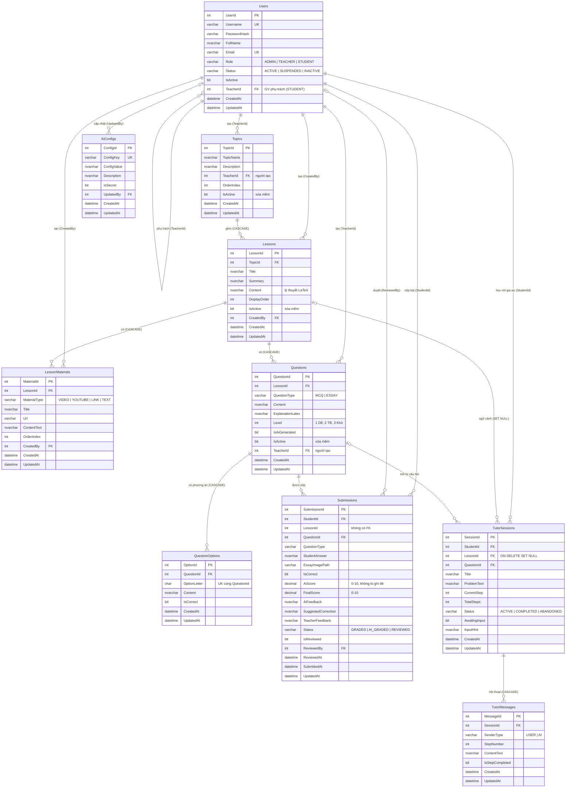

# ERD — CSDL MathTutorDB (EduTutor Math 12)

> Nguồn sự thật: `document/sql/01_schema.sql` (10 bảng). Sơ đồ dùng cú pháp Mermaid — xem trực tiếp trên GitHub, VS Code (extension Markdown Preview Mermaid) hoặc dán vào https://mermaid.live để xuất PNG/SVG.

## 1. Sơ đồ quan hệ thực thể

## 2. Danh sách khóa ngoại

| Bảng con | Cột | Bảng cha | Khi xóa cha |
|---|---|---|---|
| Users | TeacherId | Users | NO ACTION |
| Topics | TeacherId | Users | NO ACTION |
| Lessons | TopicId | Topics | CASCADE |
| Lessons | CreatedBy | Users | NO ACTION |
| LessonMaterials | LessonId | Lessons | CASCADE |
| LessonMaterials | CreatedBy | Users | NO ACTION |
| Questions | LessonId | Lessons | CASCADE |
| Questions | TeacherId | Users | NO ACTION |
| QuestionOptions | QuestionId | Questions | CASCADE |
| Submissions | StudentId | Users | NO ACTION |
| Submissions | QuestionId | Questions | NO ACTION |
| Submissions | ReviewedBy | Users | NO ACTION |
| AiConfigs | UpdatedBy | Users | NO ACTION |
| TutorSessions | StudentId | Users | NO ACTION |
| TutorSessions | LessonId | Lessons | SET NULL |
| TutorSessions | QuestionId | Questions | NO ACTION |
| TutorMessages | SessionId | TutorSessions | CASCADE |

## 3. Ghi chú

- **6 bảng lõi:** Users, Topics, Lessons, Questions, Submissions, TutorSessions.
- **4 bảng phụ (chuẩn hóa):** LessonMaterials, QuestionOptions, TutorMessages (thuộc tính đa trị 1–N), AiConfigs (cấu hình).
- `Submissions.LessonId` là cột thường, **không có FK** (chỉ lưu để thống kê tiến độ).
- Ràng buộc UNIQUE: `Users(Username)`, `Users(Email)`, `QuestionOptions(QuestionId, OptionLetter)`, `AiConfigs(ConfigKey)`.
- Index: `LessonMaterials(LessonId, OrderIndex)`, `Questions(LessonId, IsActive)`, `Submissions(StudentId, SubmittedAt DESC)`, `TutorSessions(StudentId, CreatedAt DESC)`, `TutorMessages(SessionId, MessageId)`.
- Xóa mềm bằng `IsActive` (Topics, Lessons, Questions) và `Status = 'INACTIVE'` (Users).
