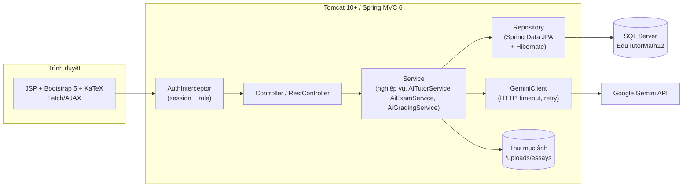
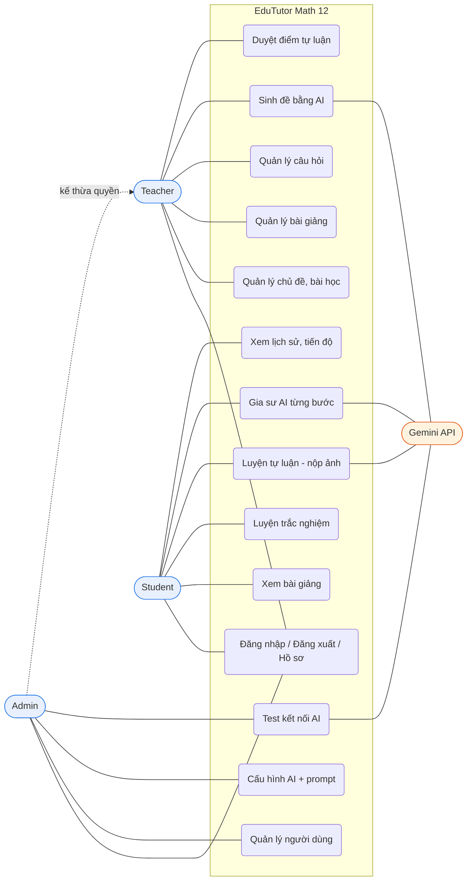
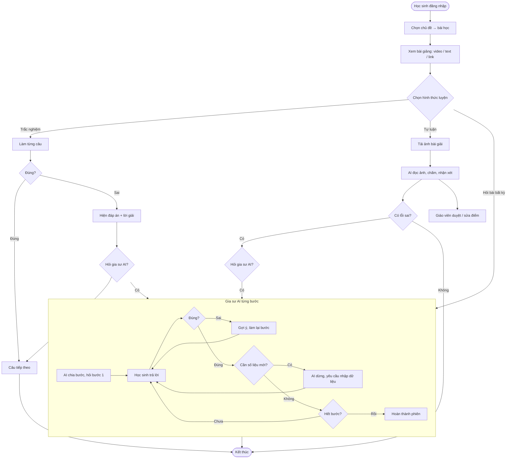
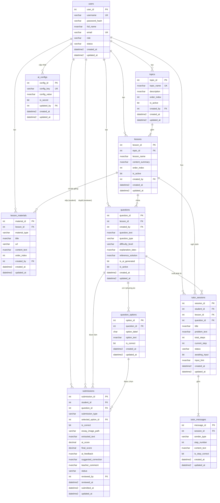

# ĐẶC TẢ YÊU CẦU PHẦN MỀM (SRS)

# HỆ THỐNG GIA SƯ & LUYỆN THI TOÁN 12 TÍCH HỢP TRÍ TUỆ NHÂN TẠO — EDUTUTOR MATH 12

| Thông tin | Nội dung |
|---|---|
| Đồ án | PRJ301 — Java Web Application |
| Phiên bản tài liệu | 2.1.1 (BR-05: xóa mềm chỉ ẩn khỏi trang quản lý, học sinh vẫn ôn tập được; nút Xóa báo trước kết quả). 2.1.0: chuyển tầng dữ liệu sang JPA; bổ sung validation nhiều lớp, đối chiếu rubric, phụ lục Q&A |
| Kiến trúc | Spring MVC 6 (framework chọn từ danh sách của rubric), Jakarta Servlet 6.0, **Spring Data JPA + Hibernate 6.6**, Jakarta Bean Validation, SQL Server |
| Giao diện | JSP + JSTL + **Bootstrap 5.3** (framework UI duy nhất) + KaTeX |
| AI | Google Gemini REST API (model cấu hình được trong CSDL) |
| Tài liệu đi kèm | `EduTutor_FRS.md` (đặc tả chức năng chi tiết), `EduTutor_Database.sql` (DDL + dữ liệu mẫu) |
| Quy ước tham chiếu | Bộ tài liệu gốc đặt trong `docs/` (`EduTutor_SRS.md`, `EduTutor_FRS.md`, `EduTutor_Database.sql`). Trong repo hiện tại các tệp này nằm ở `document/SRS.md`, `document/FRS.md` và `document/sql/*.sql`; mọi dẫn chiếu `EduTutor_*` trong tài liệu được hiểu là các tệp tương ứng này. Tài khoản mẫu: `admin`, `teacher1`, `student1`…, mật khẩu **`EduTutor@123`** |

---

## 1. GIỚI THIỆU

### 1.1. Mục đích
Tài liệu mô tả đầy đủ yêu cầu chức năng, phi chức năng, dữ liệu, giao diện và tiêu chí nghiệm thu của EduTutor Math 12. Đây là chuẩn tham chiếu cho thiết kế, lập trình, kiểm thử và bảo vệ đồ án.

### 1.2. Phạm vi
EduTutor Math 12 là website gia sư hỗ trợ học **Toán lớp 12** (Chương trình GDPT 2018) cho 3 nhóm người dùng: **Admin, Teacher, Student**. Hệ thống gồm:

- Quản lý người dùng, chủ đề, bài học và **bài giảng** (video, YouTube, văn bản, liên kết). Hai cấp **Chủ đề → Bài học** đóng vai trò "chuyên đề / môn học" của Toán 12; giao diện hiển thị nhãn **"Chuyên đề / Môn học"**.
- Ngân hàng câu hỏi **trắc nghiệm và tự luận**; giáo viên có thể nhờ AI sinh đề.
- Luyện tập trắc nghiệm, nhận phản hồi tức thì; khi làm sai, học sinh được **gia sư AI hướng dẫn từng bước**.
- Luyện tập tự luận: học sinh **chụp/tải ảnh bài giải viết tay**, AI nhận diện, chấm và nhận xét; giáo viên duyệt lại điểm.
- Admin **cấu hình AI** (khóa API, model, tham số, prompt) từ giao diện, không cần sửa code.

**Phạm vi nội dung:** Toán 12 với 4 chuyên đề mẫu (Đạo hàm – khảo sát hàm số; Nguyên hàm – tích phân; Oxyz; Xác suất có điều kiện). Thiết kế CSDL (`topics → lessons`) không gắn cứng với môn Toán 12, nên có thể mở rộng sang môn/lớp khác (Lý, Hóa, Sinh, Địa, Sử; lớp 6–12) bằng cách thêm bảng `subjects` và cột `grade` mà không đổi kiến trúc. Gia sư AI **không giới hạn trong 4 chuyên đề**: học sinh có thể hỏi bất kỳ bài toán phổ thông nào (xem FR-TUT-01).

### 1.3. Đối chiếu yêu cầu đề bài

| Mã | Yêu cầu tối thiểu của đề bài | Đáp ứng bởi |
|---|---|---|
| R1 | 3 role: Admin / Teacher / Student | FR-AUTH-06, FR-ADM-*, FR-TEA-*, FR-STU-* |
| R2 | Bài giảng: video, text, link website/YouTube | FR-TEA-03, FR-STU-02 (bảng `lesson_materials`) |
| R3 | Ngân hàng câu hỏi trắc nghiệm / tự luận; AI để sinh | FR-TEA-04, FR-TEA-05, FR-TEA-06 |
| R4 | Dùng API AI tương tác theo từng bước khi học sinh trả lời sai (cấu hình API) | FR-STU-05, FR-TUT-*, FR-OCR-04, FR-ADM-06 |
| R5 | AI giải được bất kỳ bài phổ thông khi được hỏi, khác biệt là cấu hình để tương tác | FR-TUT-01 (hỏi tự do), prompt cấu hình ở FR-ADM-06 |
| R6 | Tương tác giải từng bước; AI dừng lại bắt học sinh nhập số liệu/dữ liệu mới rồi mới giải tiếp | FR-TUT-02, FR-TUT-04 |
| R7 | Admin đủ quyền thêm giáo viên, học sinh… | FR-ADM-01 → FR-ADM-05 |
| R8 | Giáo viên thêm bài giảng, câu hỏi, chủ đề, môn học | FR-TEA-01 → FR-TEA-06. Hệ thống tổ chức phân cấp **Chủ đề (`topics`) → Bài học (`lessons`)**; hai cấp này đóng vai trò các chuyên đề môn học của Toán 12 và được gắn nhãn **"Chuyên đề / Môn học"** trên giao diện. Thực thể `Subject` (môn học cấp cao, nhiều môn/nhiều lớp) là **hướng mở rộng (Future Scope)** nêu ở mục 1.2, chưa thuộc phạm vi hiện tại |
| R9 | Học sinh chọn bài, chủ đề, bắt đầu luyện trắc nghiệm, nhận nhận xét AI cho câu sai | FR-STU-01, 03, 04, 05 |
| R10 | Học sinh luyện tự luận, up ảnh chữ viết tay, nhận nhận xét AI cho câu sai | FR-STU-07, FR-OCR-01 → 04 |
| R11 | Giao diện dùng 1 framework bất kỳ | Bootstrap 5.3 (mục 2.5) |

### 1.4. Thuật ngữ

| Thuật ngữ | Ý nghĩa |
|---|---|
| SRS / FRS | Đặc tả yêu cầu phần mềm / Đặc tả chức năng chi tiết |
| MVC | Model – View – Controller (Spring MVC / MVC2) |
| JPA / ORM | Jakarta Persistence – đặc tả ánh xạ đối tượng–quan hệ; **Hibernate** là bản hiện thực (provider) |
| Entity | Lớp Java ánh xạ một bảng CSDL (`@Entity`); khác DTO dùng để trao đổi với client |
| N+1 | Lỗi hiệu năng: 1 truy vấn danh sách kéo theo N truy vấn con; tránh bằng `LAZY` + `IN`/`EntityGraph` |
| DTO | Data Transfer Object |
| LLM | Mô hình ngôn ngữ lớn (Gemini) |
| OCR | Nhận dạng ký tự; ở đây dùng khả năng đọc ảnh đa phương thức của Gemini |
| KaTeX | Thư viện hiển thị công thức LaTeX trên web |
| Prompt / System Instruction | Chỉ dẫn điều khiển hành vi của LLM |
| CSRF / XSS | Các kiểu tấn công web thường gặp |

### 1.5. Cấu trúc tài liệu
Mục 2: tổng quan • Mục 3: yêu cầu chức năng • Mục 4: use case và luồng nghiệp vụ • Mục 5: giao diện • Mục 6: dữ liệu • Mục 7: phi chức năng • Mục 8: quy tắc nghiệp vụ và validation • Mục 9: kiểm thử và nghiệm thu • Mục 10: đối chiếu rubric.

---

## 2. MÔ TẢ TỔNG QUAN

### 2.1. Kiến trúc hệ thống

Mô hình **MVC2**: Controller nhận request → Service xử lý nghiệp vụ → Repository (Spring Data JPA/Hibernate, Entity) truy cập CSDL → Service map sang DTO → trả `Model` cho View (JSP) hoặc JSON.

### 2.2. Nhóm người dùng

| Vai trò | Quyền chính |
|---|---|
| **Admin** | Toàn quyền quản lý người dùng (tạo giáo viên/học sinh/admin, sửa, khóa, xóa, đặt lại mật khẩu); cấu hình AI và prompt; kiểm tra kết nối AI; xem thống kê; có mọi quyền của Teacher |
| **Teacher** | Quản lý chủ đề, bài học, bài giảng, ngân hàng câu hỏi; sinh đề bằng AI; xem kết quả học sinh; duyệt/điều chỉnh điểm tự luận |
| **Student** | Đăng ký, hồ sơ cá nhân; xem bài giảng; luyện trắc nghiệm và tự luận; hỏi gia sư AI; xem lịch sử và tiến độ |

### 2.3. Môi trường vận hành

| Thành phần | Công nghệ |
|---|---|
| Ngôn ngữ / JDK | Java 17 LTS |
| Server | Apache Tomcat 10.1+ (Jakarta Servlet 6.0) |
| Framework | Spring MVC 6, Spring Data JPA 3.5 + Hibernate ORM 6.6, Hibernate Validator 8, HikariCP, Jackson, BCrypt (spring-security-crypto), JSoup |
| CSDL | Microsoft SQL Server 2019+ |
| Giao diện | JSP, Jakarta JSTL 3.0, Bootstrap 5.3, Bootstrap Icons, KaTeX 0.16 |
| IDE | Apache NetBeans 17 (Maven Web Application) |
| AI | Gemini REST API qua `java.net.http.HttpClient` |
| Build | Maven |

### 2.4. Ràng buộc, giả định
- Dự án học tập: triển khai một máy chủ, không cần cluster.
- Cần Internet và khóa API hợp lệ để dùng chức năng AI. Khi AI lỗi, các chức năng không dùng AI vẫn hoạt động bình thường.
- **Tên model Gemini thay đổi theo thời gian** (các dòng 1.5 và 2.0 đã ngừng, 2.5-flash có lịch ngừng cuối năm 2026). Vì vậy tên model **không hard-code**, được lưu trong `ai_configs` và Admin đổi được. Giá trị mặc định: `gemini-3.5-flash`; cần đối chiếu tại trang deprecations của `ai.google.dev` trước khi demo.
- Đề bài, lời giải do AI sinh có thể sai: giáo viên bắt buộc xem trước khi lưu (BR-08); điểm AI chấm tự luận là đề xuất, giáo viên có quyền chỉnh (BR-09).

### 2.5. Lựa chọn framework (đáp ứng R11 và rubric)
- Rubric yêu cầu dùng **1 framework trong danh sách** (JSF, Struts, Hibernate, GWT, Vaadin, Wicket, Vert.x, Spring MVC, Play, Grails…): đồ án chọn **Spring MVC** làm framework web chính; tầng dữ liệu dùng **JPA với Hibernate** (cũng thuộc danh sách) thông qua Spring Data JPA.
- Giao diện dùng **một** framework UI duy nhất: **Bootstrap 5.3**, kèm một layout JSP chung (header, sidebar theo vai trò, footer).

---

## 3. YÊU CẦU CHỨC NĂNG

Ưu tiên: **M** = bắt buộc (Must), **S** = nên có (Should). Chi tiết từng chức năng ở FRS.

### 3.1. Xác thực và hồ sơ (AUTH)

| Mã | Yêu cầu | Ưu tiên |
|---|---|---|
| FR-AUTH-01 | Học sinh tự đăng ký (role mặc định STUDENT); `username`, `email` duy nhất | M |
| FR-AUTH-02 | Đăng nhập; chỉ tài khoản `ACTIVE` đăng nhập được; lưu `LOGGED_IN_USER` trong `HttpSession`; đổi session ID sau đăng nhập; session timeout 30 phút | M |
| FR-AUTH-03 | Đăng xuất, hủy session | M |
| FR-AUTH-04 | Xem và sửa hồ sơ cá nhân (họ tên, email) | S |
| FR-AUTH-05 | Đổi mật khẩu (yêu cầu mật khẩu cũ) | S |
| FR-AUTH-06 | `AuthInterceptor` phân quyền theo URL cho cả trang và API (`/admin/**`, `/teacher/**`, `/student/**`, `/api/**`) | M |

### 3.2. Quản trị (ADM)

| Mã | Yêu cầu | Ưu tiên |
|---|---|---|
| FR-ADM-01 | Danh sách người dùng có tìm kiếm (tên, username, email), lọc theo vai trò/trạng thái, **phân trang** | M |
| FR-ADM-02 | **Tạo** tài khoản với vai trò bất kỳ (TEACHER, STUDENT, ADMIN) | M |
| FR-ADM-03 | Sửa thông tin và đổi vai trò người dùng | M |
| FR-ADM-04 | Khóa tài khoản (`ACTIVE → SUSPENDED`) và mở khóa (`SUSPENDED → ACTIVE`); xóa tài khoản: xóa cứng nếu chưa có dữ liệu liên quan, ngược lại xóa mềm sang `INACTIVE`. Tài khoản `INACTIVE` không dùng thao tác "mở khóa" mà được Admin **khôi phục** bằng chức năng riêng (`INACTIVE → ACTIVE`) | M |
| FR-ADM-05 | Đặt lại mật khẩu cho người dùng | S |
| FR-ADM-06 | Xem/sửa cấu hình AI: khóa API, model, temperature, token, timeout, giới hạn gọi (học sinh / giáo viên), số bước tutor và **3 prompt** (Tutor, Sinh đề, Chấm bài); có validate | M |
| FR-ADM-07 | Kiểm tra kết nối Gemini (ping) và hiển thị kết quả | M |
| FR-ADM-08 | Dashboard thống kê từ **dữ liệu lưu bền vững trong CSDL**: số người dùng theo vai trò/trạng thái, số câu hỏi (trong đó do AI sinh), số lượt làm bài, **số phiên gia sư AI đã tạo**, **số bài tự luận đã chấm qua AI**. Không thống kê "tổng số request AI thô" (bộ đếm trong RAM) | S |

### 3.3. Giáo viên (TEA)

| Mã | Yêu cầu | Ưu tiên |
|---|---|---|
| FR-TEA-01 | CRUD chủ đề (topics); không xóa chủ đề còn bài học đang hoạt động (BR-05) | M |
| FR-TEA-02 | CRUD bài học (lessons); không xóa bài học còn câu hỏi **đang hoạt động** (`is_active = 1`, BR-05) | M |
| FR-TEA-03 | CRUD **bài giảng** của bài học: `VIDEO` (URL), `YOUTUBE` (URL), `LINK` (website), `TEXT` (nội dung có LaTeX) | M |
| FR-TEA-04 | CRUD câu hỏi trắc nghiệm (4 phương án, 1 đúng) và tự luận (đáp án/barem cho AI); danh sách có lọc + phân trang | M |
| FR-TEA-05 | Sinh câu hỏi trắc nghiệm bằng AI theo chủ đề, bài, độ khó, số lượng; xem trước và chỉnh sửa | M |
| FR-TEA-06 | Lưu hàng loạt câu hỏi AI đã duyệt (`is_ai_generated = 1`) | M |
| FR-TEA-07 | Danh sách bài tự luận cần duyệt: xem ảnh, văn bản AI nhận diện, điểm AI, nhận xét; **sửa điểm** và thêm nhận xét giáo viên | M |
| FR-TEA-08 | Xem kết quả làm bài của học sinh theo bài học/câu hỏi: với trắc nghiệm hiển thị song song **tỉ lệ đúng** (`correct_pct`) và **điểm trung bình thang 10** (`avg_score = correct_pct / 10`) | S |
| FR-TEA-09 | Dashboard giáo viên: số bài chờ duyệt, câu hỏi gần đây | S |

### 3.4. Học sinh (STU)

| Mã | Yêu cầu | Ưu tiên |
|---|---|---|
| FR-STU-01 | Duyệt chủ đề → bài học; chọn bài để học/luyện | M |
| FR-STU-02 | Xem bài học và **bài giảng** (nhúng YouTube/video, đọc văn bản KaTeX, mở link) | M |
| FR-STU-03 | Bắt đầu luyện trắc nghiệm theo bài học (lọc độ khó, xáo trộn thứ tự câu) | M |
| FR-STU-04 | Nộp từng câu, **chấm tức thì**; nếu sai: hiển thị đáp án đúng và lời giải chi tiết | M |
| FR-STU-05 | Khi sai: nút **"Hỏi gia sư AI"** mở phiên tutor với đề bài và đáp án đã chọn | M |
| FR-STU-06 | Lịch sử làm bài (phân trang) và tiến độ: dashboard hiển thị tiến độ tổng hợp **theo Chủ đề**; bấm vào một chủ đề để xem tiến độ bóc tách **theo từng Bài học** | M |
| FR-STU-07 | Chọn bài học → danh sách câu tự luận → làm bài (chuyển sang FR-OCR-01) | M |

### 3.5. Gia sư AI từng bước (TUT)

| Mã | Yêu cầu | Ưu tiên |
|---|---|---|
| FR-TUT-01 | Tạo phiên gia sư từ: (a) **bài toán nhập tự do** (không cần chọn bài), (b) một bài học, (c) một câu trắc nghiệm vừa sai, (d) một bài tự luận vừa chấm | M |
| FR-TUT-02 | AI chia bài toán thành `TUTOR_MIN_STEPS`–`TUTOR_MAX_STEPS` bước, mỗi lượt chỉ hỏi **một** bước; không đưa đáp án cuối ngay | M |
| FR-TUT-03 | Học sinh đúng → khen và sang bước kế; sai → chỉ ra lỗi, gợi ý, yêu cầu làm lại bước hiện tại | M |
| FR-TUT-04 | Khi bước cần số liệu/dữ liệu mới, AI **dừng lại, yêu cầu học sinh nhập** (`needsStudentInput`); server ghi trạng thái chờ vào `tutor_sessions.awaiting_input = 1` (kèm `input_hint`) và chỉ tiếp tục khi học sinh cung cấp dữ liệu (xem BR-15) | M |
| FR-TUT-05 | Kết thúc phiên khi hoàn thành (`COMPLETED`); xem lại và tiếp tục phiên cũ; học sinh có thể chủ động kết thúc (`ABANDONED`) | M |

### 3.6. Chấm tự luận qua ảnh (OCR)

| Mã | Yêu cầu | Ưu tiên |
|---|---|---|
| FR-OCR-01 | Học sinh tải ảnh bài giải (JPG/PNG/WebP, ≤ 5 MB), hỗ trợ chụp từ camera điện thoại | M |
| FR-OCR-02 | AI đọc ảnh, chép lại nội dung toán, kiểm tra từng bước, chấm thang 10 (làm tròn 0.25), chỉ vị trí sai, nêu lời giải đúng | M |
| FR-OCR-03 | Lưu bài nộp và kết quả; học sinh xem lại ảnh + nhận xét; điểm AI chỉ là đề xuất cho tới khi giáo viên duyệt | M |
| FR-OCR-04 | Nút **"Hỏi gia sư AI về lỗi sai"** mở phiên tutor từ bài tự luận vừa chấm | M |

---

## 4. USE CASE VÀ LUỒNG NGHIỆP VỤ

### 4.1. Sơ đồ use case

### 4.2. Luồng nghiệp vụ tổng thể

---

## 5. YÊU CẦU GIAO DIỆN

### 5.1. Nguyên tắc
- Một layout JSP chung (`layout.jsp`): thanh điều hướng trên cùng + menu bên theo vai trò + vùng nội dung; Bootstrap 5.3 responsive, dùng được trên điện thoại (cần cho chụp ảnh bài làm).
- Công thức toán hiển thị bằng KaTeX trên mọi màn hình có nội dung toán (đề, đáp án, lời giải, chat tutor, nhận xét AI).
- Mọi thao tác gọi AI hiển thị trạng thái đang xử lý (spinner), khóa nút gửi để tránh gửi trùng, và thông báo lỗi thân thiện khi thất bại.
- Phân trang, thông báo (flash message) và xác nhận trước khi xóa theo một mẫu thống nhất. Hộp xác nhận xóa chủ đề / bài học / câu hỏi **báo trước kết quả** do server tính (BR-05): *xóa hẳn* (chưa có học sinh làm, không hoàn tác được), *ẩn khỏi trang quản lý* (xóa mềm, đã có lịch sử) hoặc *không thể xóa* (còn mục con đang hoạt động — nút Xóa bị khóa, hiện lý do).

### 5.2. Sơ đồ điều hướng (sitemap) và danh sách màn hình

| Vai trò | URL | Màn hình |
|---|---|---|
| Công khai | `/login`, `/register` | Đăng nhập, đăng ký |
| Chung | `/profile`, `/profile/password` | Hồ sơ, đổi mật khẩu |
| Admin | `/admin/dashboard` | Thống kê hệ thống |
| Admin | `/admin/users`, `/admin/users/new`, `/admin/users/{id}/edit` | Danh sách / tạo / sửa người dùng |
| Admin | `/admin/ai-config` | Cấu hình AI, prompt, nút Test kết nối |
| Teacher | `/teacher/dashboard` | Tổng quan |
| Teacher | `/teacher/topics`, `/teacher/lessons` | Quản lý chủ đề, bài học |
| Teacher | `/teacher/lessons/{id}/materials` | Quản lý bài giảng |
| Teacher | `/teacher/questions`, `/teacher/questions/new` | Ngân hàng câu hỏi, soạn câu hỏi |
| Teacher | `/teacher/questions/generate` | Sinh đề bằng AI (modal xem trước) |
| Teacher | `/teacher/submissions/essay`, `/teacher/submissions/essay/{id}` | Duyệt bài tự luận |
| Teacher | `/teacher/results` | Kết quả học sinh |
| Student | `/student/dashboard` | Tổng quan, tiến độ |
| Student | `/student/topics`, `/student/lessons/{id}` | Chọn chủ đề/bài, xem bài giảng |
| Student | `/student/quiz?lessonId=` | Luyện trắc nghiệm |
| Student | `/student/essay?lessonId=`, `/student/essay/{questionId}` | Chọn câu tự luận, nộp ảnh |
| Student | `/student/tutor`, `/student/tutor/{sessionId}` | Danh sách phiên, khung chat gia sư |
| Student | `/student/topics/{topicId}/progress` | Tiến độ chi tiết theo từng bài học của một chủ đề |
| Student | `/student/history` | Lịch sử làm bài |

### 5.3. Giao diện với hệ thống ngoài (Gemini)
- Giao thức: HTTPS REST, `POST https://generativelanguage.googleapis.com/v1beta/models/{model}:generateContent`.
- Xác thực bằng header `x-goog-api-key` (không đặt khóa trong URL để tránh lộ vào log).
- Dữ liệu vào: `systemInstruction`, `contents` (văn bản và/hoặc ảnh `inline_data` base64), `generationConfig` (`temperature`, `maxOutputTokens`, `responseMimeType: application/json`, `responseSchema`).
- Chi tiết định dạng ở FRS mục 4.

---

## 6. YÊU CẦU DỮ LIỆU

### 6.1. Sơ đồ quan hệ thực thể (ERD)

### 6.2. Từ điển dữ liệu tóm tắt (10 bảng, chuẩn hóa 3NF)

| Bảng | Mục đích | Khóa ngoại | Ràng buộc chính |
|---|---|---|---|
| `users` | Tài khoản 3 vai trò | — | `username`, `email` duy nhất; `role ∈ {ADMIN, TEACHER, STUDENT}`; `status ∈ {ACTIVE, SUSPENDED, INACTIVE}` (ý nghĩa ở bảng trạng thái bên dưới) |
| `topics` | Chuyên đề (cấp trên của bài học) | `created_by → users` | `topic_name` duy nhất; `order_index INT NOT NULL DEFAULT 1`; `is_active BIT NOT NULL DEFAULT 1` (xóa mềm khi đã có lịch sử; chỉ ẩn ở trang quản lý, BR-05) |
| `lessons` | Bài học | `topic_id → topics`, `created_by → users` | `order_index INT NOT NULL DEFAULT 1`; `is_active BIT NOT NULL DEFAULT 1` (xóa mềm khi đã có lịch sử; chỉ ẩn ở trang quản lý, BR-05) |
| `lesson_materials` | Bài giảng (video/YouTube/link/text) | `lesson_id → lessons` (cascade), `created_by → users` | `material_type ∈ {VIDEO, YOUTUBE, LINK, TEXT}`; TEXT bắt buộc `content_text`, loại khác bắt buộc `url`; `order_index INT NOT NULL DEFAULT 1` |
| `questions` | Ngân hàng câu hỏi | `lesson_id`, `created_by` | `question_type ∈ {MULTIPLE_CHOICE, ESSAY}`; `difficulty_level ∈ {EASY, MEDIUM, HARD, ADVANCED}`; `reference_solution` chỉ dùng cho AI chấm; `is_active BIT NOT NULL DEFAULT 1` (0 = xóa mềm, BR-05) |
| `question_options` | Phương án A–D | `question_id → questions` (cascade) | `(question_id, option_label)` duy nhất |
| `submissions` | Bài làm trắc nghiệm và tự luận | `student_id`, `question_id`, `selected_option_id`, `reviewed_by` | Điểm thang 10 (`0..10`); `ai_score` giữ nguyên, `final_score` là điểm chính thức; `status ∈ {GRADED, AI_GRADED, REVIEWED}`; có `ai_feedback`, `suggested_correction`, `teacher_comment` (≤ 1.000 ký tự), `reviewed_at` |
| `ai_configs` | Cấu hình và prompt AI | `updated_by → users` | `config_key` duy nhất; `is_secret` cho khóa API |
| `tutor_sessions` | Phiên gia sư | `student_id`, `lesson_id` (null), `question_id` (null) | `status ∈ {ACTIVE, COMPLETED, ABANDONED}`; `title NVARCHAR(100) NOT NULL` (≤ 100 ký tự đầu của đề); `awaiting_input BIT NOT NULL DEFAULT 0`; `input_hint NVARCHAR(255) NULL` |
| `tutor_messages` | Hội thoại | `session_id → tutor_sessions` (cascade) | `sender_type ∈ {USER, AI}` |

**Cột thời gian:** mọi bảng đều có `created_at DATETIME2 NOT NULL DEFAULT SYSDATETIME()` và `updated_at DATETIME2 NULL` (cập nhật khi sửa bản ghi, qua `@CreationTimestamp` / `@UpdateTimestamp`). Riêng `submissions` dùng `submitted_at` làm thời điểm tạo.

**Trạng thái tài khoản (`users.status`):**

| Giá trị | Ý nghĩa | Đăng nhập | Thao tác của Admin |
|---|---|---|---|
| `ACTIVE` | Đang hoạt động | Được | Khóa → `SUSPENDED`; xóa |
| `SUSPENDED` | Khóa tạm thời | Không | **Mở khóa** → `ACTIVE`; xóa |
| `INACTIVE` | Xóa mềm (đã có dữ liệu liên quan, BR-06) | Không | **Khôi phục** → `ACTIVE` (dữ liệu liên quan còn nguyên); không áp dụng khóa / mở khóa / sửa / đặt lại mật khẩu cho tới khi khôi phục |

**Trạng thái bài làm (`submissions.status`):**

| Giá trị | Áp dụng cho | Ý nghĩa |
|---|---|---|
| `GRADED` | Trắc nghiệm | Hệ thống chấm tức thì; `final_score` = 10 (đúng) hoặc 0 (sai); không cần duyệt |
| `AI_GRADED` | Tự luận | AI đã đọc ảnh và chấm; `ai_score` là đề xuất, `final_score` ban đầu = `ai_score`; chờ giáo viên duyệt |
| `REVIEWED` | Tự luận | Giáo viên đã duyệt / chỉnh `final_score`, thêm `teacher_comment`, ghi `reviewed_by`, `reviewed_at`; `ai_score` giữ nguyên |

Ghi chú thiết kế:
- Rubric nêu "5–6 bảng"; đồ án có **6 bảng lõi** (`users`, `topics`, `lessons`, `questions`, `submissions`, `tutor_sessions`) cộng **4 bảng phụ** xuất hiện *do chuẩn hóa*: `lesson_materials`, `question_options`, `tutor_messages` là thuộc tính đa trị (quan hệ 1–N) buộc phải tách để đạt 1NF/3NF; `ai_configs` lưu cấu hình AI để Admin đổi không cần sửa code. Có thể nhóm thành 4 cụm: *người dùng* (users) • *nội dung* (topics, lessons, lesson_materials, questions, question_options) • *kết quả* (submissions) • *AI* (ai_configs, tutor_sessions, tutor_messages).
- Mỗi bảng ánh xạ **một Entity JPA** (10 Entity); `hbm2ddl.auto=none` — script SQL là nguồn sự thật, Hibernate không tự sửa cấu trúc.
- Điểm trắc nghiệm quy ra thang 10 (đúng = 10, sai = 0) để thống nhất với tự luận; `is_correct` giữ kết quả đúng/sai.
- Script đầy đủ (DDL, chỉ mục, dữ liệu mẫu) trong `EduTutor_Database.sql` (trong repo: `document/sql/01…06`). Mật khẩu mẫu của mọi tài khoản seed là **`EduTutor@123`** (đạt VAL-02), được lưu dạng BCrypt.

### 6.3. Lưu trữ file
Ảnh bài tự luận lưu ngoài thư mục web, tại `${app.upload-dir}/essays/{studentId}/{uuid}.{ext}`; CSDL chỉ lưu đường dẫn tương đối. Ảnh chỉ được phục vụ qua controller có kiểm tra quyền (chủ bài, giáo viên, admin).

---

## 7. YÊU CẦU PHI CHỨC NĂNG

| Mã | Nhóm | Yêu cầu | Cách kiểm chứng |
|---|---|---|---|
| NFR-01 | Hiệu năng | Thao tác CSDL thông thường phản hồi < 1 s với ≥ 1.000 câu hỏi; dùng HikariCP, chỉ mục, phân trang ở DB, quan hệ `LAZY`, không N+1 | Đo thời gian trang danh sách; soi log `org.hibernate.SQL` (TC-DB-03) |
| NFR-02 | Hiệu năng AI | Gọi AI chạy bất đồng bộ phía client (Fetch + spinner); phía server dùng `CompletableFuture`/`DeferredResult` để không giữ luồng Tomcat; timeout 30 s (ảnh 60 s) | Demo với mạng chậm |
| NFR-03 | Bảo mật | 100% truy vấn tham số hóa (JPA/Hibernate dùng `PreparedStatement`, cấm nối chuỗi JPQL/SQL); không bind request thẳng vào Entity; mật khẩu băm **BCrypt**; `<c:out>`/escape và JSoup sanitize nội dung hiển thị; CSRF token cho mọi form/POST; cookie session `HttpOnly`, `SameSite=Lax`; đổi session ID sau đăng nhập | Review code + thử tấn công cơ bản |
| NFR-04 | Phân quyền | Mọi URL (kể cả `/api/**`) kiểm tra vai trò ở server; không tin dữ liệu ẩn từ client; học sinh chỉ truy cập dữ liệu của mình | Test case TC-SEC |
| NFR-05 | Bảo mật dữ liệu AI | Khóa API chỉ hiển thị dạng che (`AIza****abcd`), không ghi vào log; file upload kiểm tra phần mở rộng, MIME và *magic bytes*, đổi tên ngẫu nhiên | Review |
| NFR-06 | Kiểm soát chi phí | Giới hạn gọi AI theo `(userId, vai trò/hành động)`: học sinh `AI_RATE_LIMIT_PER_HOUR` (mặc định 60/giờ, gia sư + chấm ảnh); giáo viên `AI_RATE_LIMIT_TEACHER_PER_HOUR` (mặc định 300/giờ, sinh đề); Admin được miễn cho thao tác Test kết nối. Vượt hạn trả HTTP 429 | TC-AI-08 |
| NFR-07 | Độ tin cậy | `@ControllerAdvice` xử lý lỗi tập trung; AI trả JSON sai cú pháp → thử lại tối đa 3 lần; lỗi HTTP 429/5xx → thử lại tối đa 2 lần với chờ lũy tiến; AI hỏng không làm sập chức năng khác | TC-AI-06, 07 |
| NFR-08 | Toàn vẹn dữ liệu | Thao tác nhiều bước (tạo câu hỏi + 4 phương án, lưu hàng loạt) dùng `@Transactional` (`JpaTransactionManager`); không giữ transaction khi chờ AI | Test rollback |
| NFR-09 | Khả dụng | Responsive (≥ 360 px), thông báo lỗi rõ ràng, hiển thị đúng ký hiệu toán GDPT 2018 | Kiểm tra trên điện thoại |
| NFR-10 | Bảo trì | Phân tầng Controller–Service–Repository, Entity JPA tách khỏi DTO, thành phần giao diện dùng lại (tag file), cấu hình ngoài code (`application.properties`, `ai_configs`), log SLF4J | Review cấu trúc package |
| NFR-11 | Tương thích | Chrome/Edge/Firefox bản mới; Tomcat 10.1+; JDK 17; chạy được từ NetBeans 17 | Chạy thử |

---

## 8. QUY TẮC NGHIỆP VỤ VÀ VALIDATION

### 8.1. Quy tắc nghiệp vụ

| Mã | Quy tắc |
|---|---|
| BR-01 | Chỉ tài khoản `ACTIVE` mới đăng nhập được (`SUSPENDED`, `INACTIVE` bị từ chối); tài khoản bị khóa đang đăng nhập sẽ bị chặn ở request kế tiếp. `SUSPENDED` được mở khóa; `INACTIVE` (xóa mềm) được Admin khôi phục về `ACTIVE` |
| BR-02 | Hệ thống phải luôn còn ít nhất 1 Admin `ACTIVE`; không cho khóa/xóa/hạ quyền Admin cuối cùng; Admin không tự khóa chính mình |
| BR-03 | Áp dụng cho **toàn bộ tài nguyên giáo viên**: chủ đề (`topics`), bài học (`lessons`), bài giảng (`lesson_materials`) và câu hỏi (`questions`). Giáo viên chỉ sửa/xóa mục có `created_by` là mình; Admin có toàn quyền trên toàn hệ thống. Mọi giáo viên vẫn được *xem* nội dung dùng chung |
| BR-04 | Câu trắc nghiệm có đúng 4 phương án A–D và đúng 1 phương án đúng; câu tự luận không có phương án |
| BR-05 | Việc xóa luôn do **giáo viên / Admin chủ động** bấm Xóa và xác nhận; hệ thống chỉ quyết định *cách* xóa. **Câu hỏi:** đã có bài nộp (hoặc phiên gia sư mở từ câu đó) thì chuyển `is_active = 0` (xóa mềm), chưa có thì xóa hẳn. **Bài học:** không xóa nếu còn câu hỏi *đang hoạt động*; kiểm tra bằng `countByLessonIdAndIsActiveTrue(lessonId) == 0`. Nếu chỉ còn câu hỏi đã xóa mềm (`is_active = 0`) thì cho phép xóa: xóa cứng khi không còn bài nộp / phiên gia sư liên quan, ngược lại xóa mềm bài học (`lessons.is_active = 0`). **Chủ đề:** không xóa nếu còn bài học *đang hoạt động*; xóa cứng khi không còn bài học nào, ngược lại xóa mềm (`topics.is_active = 0`). **Phạm vi ẩn:** bản ghi xóa mềm chỉ bị ẩn ở **phía quản lý** (danh sách, sửa/xóa, chọn bài học khi soạn câu hỏi / sinh đề / thêm bài giảng, số liệu dashboard giáo viên và Admin chỉ lấy `is_active = 1`). **Phía học sinh** vẫn thấy và dùng bình thường (danh sách chủ đề / bài học, bài giảng, luyện trắc nghiệm, tự luận, gia sư AI) để **ôn tập**; lịch sử làm bài giữ nguyên. Tên chủ đề chỉ cần duy nhất trong các chủ đề đang hoạt động |
| BR-06 | Người dùng đã có dữ liệu liên quan chỉ được xóa mềm (`INACTIVE`) |
| BR-07 | Mọi điểm quy về thang 10; điểm tự luận làm tròn tới 0.25 |
| BR-08 | Câu hỏi do AI sinh phải được giáo viên xem trước và xác nhận mới lưu |
| BR-09 | `ai_score` không bị ghi đè; giáo viên chỉ sửa `final_score`. Bài tự luận có `status = AI_GRADED` cho tới khi giáo viên duyệt (`REVIEWED`) |
| BR-10 | Học sinh được làm lại câu hỏi nhiều lần; tiến độ tính theo lần làm **gần nhất** của mỗi câu |
| BR-11 | Server không bao giờ gửi `is_correct`, `explanation_latex`, `reference_solution` xuống client trước khi học sinh nộp câu đó |
| BR-12 | Gia sư AI không đưa đáp án cuối ở bước đầu; số bước nằm trong khoảng `TUTOR_MIN_STEPS`–`TUTOR_MAX_STEPS`; một lượt chỉ hỏi một bước |
| BR-13 | Giới hạn gọi AI áp dụng theo `(userId, vai trò/hành động)`, cửa sổ trượt 60 phút: **học sinh** tối đa `AI_RATE_LIMIT_PER_HOUR` (mặc định 60) lượt cho gia sư (khởi tạo + từng bước) và chấm ảnh tự luận; **giáo viên** tối đa `AI_RATE_LIMIT_TEACHER_PER_HOUR` (mặc định 300, cấu hình trong `ai_configs`) lượt sinh câu hỏi; **Admin** được miễn giới hạn cho Test kết nối API. Hai nhóm hạn mức độc lập nhau |
| BR-14 | Phiên tutor chỉ thuộc về học sinh tạo ra nó; học sinh khác truy cập → 403 |
| BR-15 | Khi AI trả `needsStudentInput = true`, server đặt `tutor_sessions.awaiting_input = 1` và lưu `input_hint`. Lượt kế tiếp của học sinh được hiểu là **dữ liệu cung cấp cho bước hiện tại** (không chấm đúng/sai, không chuyển bước); server đưa dữ liệu đó vào prompt rồi đặt lại `awaiting_input = 0`, `input_hint = NULL`. Trạng thái này lưu ở CSDL nên mở lại phiên cũ vẫn đúng |

### 8.2. Bảng validation tập trung

| Mã | Trường | Quy tắc |
|---|---|---|
| VAL-01 | `username` | 4–30 ký tự, chữ/số/`_`/`.`, duy nhất |
| VAL-02 | `password` | 8–64 ký tự, có chữ và số; xác nhận phải khớp |
| VAL-03 | `email` | Đúng định dạng, ≤ 100 ký tự, duy nhất |
| VAL-04 | `fullName` | 2–100 ký tự, không chứa thẻ HTML |
| VAL-05 | `role` | Thuộc `ADMIN/TEACHER/STUDENT` |
| VAL-06 | `topic_name` | 3–200 ký tự, duy nhất |
| VAL-07 | `lesson_name` | 3–200 ký tự |
| VAL-08 | `material_type` / `url` / `content_text` | Loại hợp lệ; URL bắt đầu `http://` hoặc `https://`; YOUTUBE phải là link youtube.com/youtu.be; TEXT không rỗng, ≤ 20.000 ký tự |
| VAL-09 | `question_text` | Không rỗng, ≤ 4.000 ký tự |
| VAL-10 | Phương án trắc nghiệm | Đủ A–D, không rỗng, đúng 1 đáp án đúng |
| VAL-11 | `difficulty_level` | Thuộc 4 mức |
| VAL-12 | `count` (AI sinh đề) | Số nguyên 1–10 |
| VAL-13 | `TUTOR_TEMPERATURE`, `QUIZ_TEMPERATURE`, `GRADING_TEMPERATURE` | Số thực 0.0–1.0 |
| VAL-14 | `MAX_OUTPUT_TOKENS` | Số nguyên 256–8192 |
| VAL-15 | `TUTOR_MIN_STEPS`/`MAX_STEPS` | Số nguyên 2–10 và MIN ≤ MAX |
| VAL-16 | `AI_TIMEOUT_SECONDS` | 5–120 |
| VAL-17 | Prompt | Không rỗng, ≤ 8.000 ký tự, giữ nguyên các placeholder `{{...}}` bắt buộc |
| VAL-18 | Ảnh tự luận | JPG/PNG/WebP, ≤ 5 MB, kiểm tra magic bytes, kích thước tối đa 4096×4096 px |
| VAL-19 | `studentInput` (tutor) | 1–2.000 ký tự |
| VAL-20 | `final_score` | 0–10, bước 0.25 |
| VAL-21 | `teacher_comment` | ≤ 1.000 ký tự |
| VAL-22 | Tham số phân trang | `page ≥ 1`, `size ∈ {10, 20, 50}` |

**Các lớp kiểm tra dữ liệu đầu vào (defense in depth):** (1) HTML5/JS ở trình duyệt; (2) **Bean Validation** trên Form/DTO ở server (VAL-xx, thông báo tiếng Việt tại từng trường); (3) quy tắc nghiệp vụ ở Service (BR-xx, ràng buộc liên trường); (4) ràng buộc `UNIQUE/CHECK/FK` trong CSDL. Lớp 1 chỉ để tiện dùng, không được coi là bảo mật.

---

## 9. KIỂM THỬ VÀ NGHIỆM THU

### 9.1. Kịch bản demo (8 bước)

Tài khoản demo (dữ liệu mẫu): `admin`, `teacher1`, `teacher2`, `student1`…`student5`; mật khẩu chung **`EduTutor@123`**.

| Bước | Vai trò | Nội dung | Kết quả mong đợi |
|---|---|---|---|
| 1 | Admin | Đăng nhập → Quản lý người dùng → tạo giáo viên mới; mở Cấu hình AI, đặt Temperature 0.3, dán khóa API, bấm **Test kết nối** | Tạo được tài khoản TEACHER; báo kết nối thành công |
| 2 | Teacher | Đăng nhập → thêm chủ đề/bài học → thêm bài giảng YouTube và văn bản KaTeX | Học sinh sẽ thấy ở bước 3 |
| 3 | Teacher | Sinh 5 câu trắc nghiệm mức Khó cho "Nguyên hàm – Tích phân" bằng AI → xem trước, sửa, lưu | Câu hỏi vào ngân hàng với `is_ai_generated = 1`, KaTeX hiển thị đúng |
| 4 | Student | Đăng ký/đăng nhập → chọn bài → xem video và lý thuyết | Video nhúng, công thức hiển thị |
| 5 | Student | Luyện trắc nghiệm, cố ý chọn sai | Hiện đáp án đúng + lời giải; có nút "Hỏi gia sư AI" |
| 6 | Student | Bấm "Hỏi gia sư AI" → tương tác từng bước (nhập $y'$, nghiệm $y'=0$, trả lời sai một bước, rồi sửa); hỏi thêm một bài ngoài 4 chuyên đề | AI không giải ngay; sai thì gợi ý; bài mới cần dữ liệu thì AI dừng chờ học sinh nhập |
| 7 | Student | Làm câu tự luận: tải ảnh bài giải viết tay có sai cận tích phân | AI chép lại bài, chỉ ra lỗi, chấm điểm; có nút hỏi gia sư |
| 8 | Teacher | Mở bài chờ duyệt, xem ảnh + OCR + điểm AI, sửa điểm, lưu | `final_score` đổi, `ai_score` giữ nguyên, trạng thái `REVIEWED` |

### 9.2. Tiêu chí nghiệm thu chính

| Mã | Tình huống | Kỳ vọng |
|---|---|---|
| TC-SEC-01 | Student gọi `POST /api/teacher/generate-questions` | HTTP 403 |
| TC-SEC-02 | Teacher truy cập `/admin/ai-config` | HTTP 403 |
| TC-SEC-03 | Chưa đăng nhập vào `/student/dashboard` | Chuyển `/login` |
| TC-SEC-04 | Nhập `' OR 1=1 --` ở ô username | Đăng nhập thất bại, không lỗi SQL |
| TC-SEC-05 | Nhập `<script>` vào tên/câu hỏi | Được escape/sanitize, không chạy |
| TC-SEC-06 | POST không có CSRF token | HTTP 403 |
| TC-SEC-07 | Student A mở phiên tutor/ảnh bài của Student B | HTTP 403 |
| TC-SEC-08 | Response `GET /student/quiz` | Không chứa `is_correct`, lời giải |
| TC-AI-01 | Test kết nối với khóa đúng / sai | Thành công / thông báo lỗi rõ |
| TC-AI-02 | Sinh 5 câu, AI trả JSON hợp lệ | Hiển thị đủ 5 câu để xem trước |
| TC-AI-03 | Tutor: gửi bài toán đầu tiên | AI không đưa đáp án cuối ngay; trả về câu hỏi bước 1; `totalSteps` nằm trong khoảng `[TUTOR_MIN_STEPS, TUTOR_MAX_STEPS]` đang cấu hình trong `ai_configs` (mặc định 3–6; giới hạn cấu hình 2–10 theo VAL-15) |
| TC-AI-04 | Tutor: trả lời sai bước | `isStepCorrect=false`, giữ nguyên bước, có gợi ý |
| TC-AI-05 | Tutor: bài cần dữ liệu mới | `needsStudentInput=true`, `awaiting_input=1`; AI chờ, không tự bịa số liệu; lượt sau học sinh nhập số liệu thì `awaiting_input` về 0 và bước không bị chấm sai/đổi |
| TC-AI-06 | AI trả JSON sai cú pháp | Tự thử lại ≤ 3 lần rồi báo lỗi thân thiện |
| TC-AI-07 | Ngắt mạng / quá timeout | Báo "AI tạm thời không phản hồi", các chức năng khác vẫn dùng được |
| TC-AI-08 | Vượt giới hạn gọi AI/giờ (học sinh vượt 60 lượt; giáo viên vượt 300 lượt sinh đề) | HTTP 429 + thông báo; Test kết nối của Admin không bị giới hạn |
| TC-OCR-01 | Tải file `.exe` đổi tên thành `.jpg` | Từ chối (magic bytes) |
| TC-OCR-02 | Tải ảnh 8 MB | Từ chối, báo dung lượng |
| TC-OCR-03 | Tải ảnh không phải bài toán | `legible=false`, báo học sinh chụp lại, không lưu điểm |
| TC-ADM-01 | Khóa Admin cuối cùng | Bị chặn (BR-02) |
| TC-ADM-02 | Mở khóa tài khoản `SUSPENDED` / thao tác trên tài khoản `INACTIVE` | `SUSPENDED` → `ACTIVE`; tài khoản `INACTIVE` không mở khóa / sửa được (409) mà chỉ có nút **Khôi phục** (`INACTIVE → ACTIVE`), sau đó đăng nhập lại được và lịch sử còn nguyên |
| TC-TEA-01 | Xóa chủ đề còn bài học | Bị chặn, thông báo rõ (nút Xóa bị khóa kèm lý do; gửi thẳng request vẫn trả 409) |
| TC-TEA-02 | Tạo câu trắc nghiệm có 2 đáp án đúng | Báo lỗi validation |
| TC-TEA-03 | Xóa bài học còn câu hỏi `is_active = 1` / bài học chỉ còn câu hỏi `is_active = 0` | Trường hợp đầu bị chặn (409); trường hợp sau được phép xóa (BR-05): còn bài nộp thì xóa mềm — ẩn ở trang quản lý của giáo viên nhưng học sinh vẫn mở bài học và luyện lại được; không còn bài nộp thì xóa hẳn |
| TC-TEA-04 | Giáo viên B sửa/xóa chủ đề, bài học, bài giảng, câu hỏi do giáo viên A tạo | HTTP 403 (BR-03); Admin thao tác được |
| TC-DB-01 | Chạy `EduTutor_Database.sql` trên SQL Server sạch | Tạo đủ 10 bảng + dữ liệu mẫu, không lỗi |
| TC-DB-02 | Khởi động ứng dụng với `hbm2ddl.auto=none` | Hibernate nạp đủ 10 Entity, không lỗi mapping; không tự sửa bảng |
| TC-DB-03 | Bật log `org.hibernate.SQL`, mở `/student/quiz` 10 câu | Số câu SQL không tăng theo số câu hỏi (không N+1) |
| TC-VAL-01 | Đăng ký với `username = ab`, mật khẩu `123` | Lỗi tiếng Việt hiển thị tại từng trường, không ghi CSDL |
| TC-VAL-02 | Gửi trực tiếp `role=ADMIN` trong form đăng ký | Bị bỏ qua; tài khoản tạo ra có vai trò STUDENT |
| TC-VAL-03 | Đăng nhập bằng tài khoản mẫu `admin / teacher1 / student1` với mật khẩu `EduTutor@123` | Thành công; mật khẩu mẫu thỏa VAL-02 (8–64 ký tự, có chữ và số) |

---

## 10. ĐỐI CHIẾU RUBRIC PRJ301

| Tiêu chí (điểm) | Nội dung đáp ứng | Vị trí |
|---|---|---|
| Database Design (10) | 6 bảng lõi + 4 bảng phụ (do chuẩn hóa) đạt 3NF, SQL Server có dữ liệu mẫu, ERD (Mermaid + ảnh PNG) | Mục 6; `EduTutor_Database.sql` |
| Business Logic (10) | Sơ đồ use case, luồng nghiệp vụ; bảng validation VAL-01…22 thực thi bằng Bean Validation + Service + DB; quy tắc BR-01…14 | Mục 4, 8 |
| User Interface (10) | Layout thống nhất Bootstrap, breadcrumb, menu theo vai trò, tag file dùng lại, responsive | Mục 5 |
| Contents (25) | Hệ thống hoàn chỉnh MVC, tích hợp AI, tài liệu SRS/FRS/SQL | Toàn bộ |
| Application (25) | Spring MVC/MVC2, Spring Data JPA/Hibernate (Specification, projection, `@EntityGraph`, native query cho CTE/NEWID, tránh N+1), session, phân trang, xử lý lỗi toàn cục, Bean Validation, bảo mật (BCrypt, CSRF, tham số hóa), thành phần dùng lại | Mục 7; FRS mục 1–3, 6 |
| AI Integration (10) | AI hoạt động thật (sinh đề, tutor, chấm ảnh); giải thích logic: prompt, sơ đồ tuần tự, JSON schema, retry | FRS mục 4–5 |
| Report (5) | Yêu cầu, thiết kế DB, chức năng, phần AI | SRS + FRS + `docs/BAO_CAO.md` |
| Demo & Q&A (5) | Kịch bản 8 bước, bộ test case, câu hỏi bảo vệ dự kiến | Mục 9; Phụ lục B |

---

## PHỤ LỤC A. Rủi ro và phương án giảm thiểu

| Rủi ro | Giảm thiểu |
|---|---|
| Model Gemini bị ngừng / đổi tên | Tên model lưu trong `ai_configs`; Admin đổi không cần deploy; kiểm tra bằng nút Test |
| AI giải sai hoặc chấm lệch | Giáo viên duyệt đề trước khi lưu; điểm AI chỉ là đề xuất, giáo viên sửa được |
| Hết quota / mạng lỗi khi demo | Rate limit, thông báo lỗi thân thiện; chuẩn bị sẵn dữ liệu mẫu và ảnh tự luận mẫu |
| Lộ khóa API | Che khóa trên giao diện, không log, không đặt trong URL |
| Học sinh lạm dụng AI | Giới hạn số lần gọi mỗi giờ (BR-13) |

---

## PHỤ LỤC B. Câu hỏi bảo vệ dự kiến (gợi ý trả lời ngắn)

| Câu hỏi | Ý chính để trả lời |
|---|---|
| Vì sao chọn Spring MVC, MVC2 hoạt động thế nào? | Một `DispatcherServlet` điều phối; Controller nhận request, Service giữ nghiệp vụ, Repository truy cập DB, View là JSP; tách tầng giúp test và bảo trì |
| JPA khác JDBC thế nào, vì sao dùng? | JPA ánh xạ bảng ↔ Entity, bớt mã lặp, dirty checking, quan hệ, phân trang; vẫn kiểm soát SQL bằng `@Query`/native khi cần |
| N+1 là gì, em tránh thế nào? | Quan hệ `LAZY`; lấy phương án của cả đề bằng một truy vấn `IN`; `@EntityGraph` cho quan hệ *to-one*; kiểm bằng log `org.hibernate.SQL` (TC-DB-03) |
| Vì sao không trả Entity ra giao diện? | Tránh lộ `password_hash`/`is_correct`, tránh `LazyInitializationException`, tránh mass assignment; dùng DTO/projection |
| Chống SQL Injection ra sao? | Mọi truy vấn có tham số; không nối chuỗi JPQL/SQL; test `' OR 1=1 --` (TC-SEC-04) |
| Chống CSRF/XSS/session fixation? | Token CSRF cho mọi POST; sanitize bằng JSoup + `<c:out>`; `changeSessionId()` sau đăng nhập; cookie `HttpOnly`, `SameSite` |
| Vì sao 10 bảng thay vì 5–6? | 6 bảng lõi; 3 bảng 1–N tách ra do chuẩn hóa (bài giảng, phương án, tin nhắn) và 1 bảng cấu hình AI để Admin đổi không cần deploy |
| Gia sư AI "từng bước" hoạt động thế nào? | Server giữ `current_step` và `awaiting_input`; AI trả JSON; server chuẩn hóa (đúng → +1, sai → giữ bước, `needsStudentInput` → `awaiting_input = 1` rồi chờ dữ liệu); AI không được tự nhảy bước hay đưa đáp án sớm |
| Nếu AI trả sai/lỗi/chậm thì sao? | Thử lại tối đa theo quy tắc; báo lỗi thân thiện; chức năng không dùng AI vẫn chạy; giáo viên duyệt đề và điểm (BR-08, BR-09) |
| Vì sao gọi AI ngoài transaction? | Không giữ kết nối DB trong lúc chờ mạng; tránh cạn pool; phần ghi DB gom vào một transaction ngắn sau khi AI trả lời |
